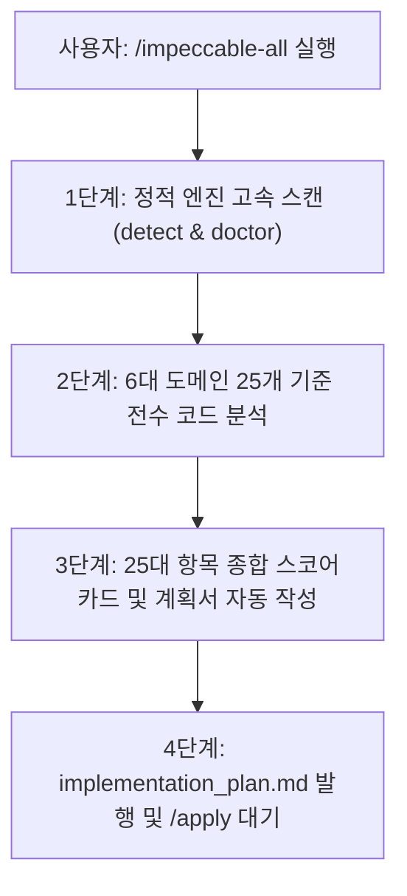

# Impeccable 25개 전수 검증 및 구현 계획서 자동 생성 스킬 (`impeccable-all`)

> [!IMPORTANT]
> **실행 목적 및 트리거 조건**
> 이 스킬은 `/impeccable-all`, `/impeccable all`, `/action impeccable-all` 명령어를 수신했을 때 실행됩니다.
> Impeccable 디자인 시스템이 제공하는 **25가지 모든 세부 검증 축**을 단 한 번의 실행으로 전수 평가하고, 그 결과를 바탕으로 **`implementation_plan.md` 구현 계획서를 자동으로 생성**한 뒤 사용자의 `/apply` 명령을 대기합니다.

---

## 📌 핵심 원칙 (Core Rules)

1. **25가지 전수 검증 종합 평가 (Comprehensive 25-Check Matrix)**:
   - 개별 명령어를 반복 호출할 필요 없이, 6대 도메인 25개 세부 검증 항목을 한 번에 전수 검사합니다.
2. **코드 수정 절대 금지 (No Auto Code Modification)**:
   - 진단 및 계획서 작성 단계에서는 프로젝트 소스 코드를 절대로 직접 수정하지 않습니다.
3. **계획서 자동 발행 (Plan-First Delivery)**:
   - 검증 결과는 25개 점검 스코어카드, 우선순위별 결함 목록(P1 긴급, P2 중요, P3 디테일), 파일별 코드 수정 지침을 포함하여 `implementation_plan.md` 아티팩트로 자동 완성합니다.
4. **`/apply` 대기 상태 유지 (Halt for User Review)**:
   - 결과 리포트를 출력한 뒤 대기하며, 사용자가 `/apply`를 입력할 때까지 코드를 변경하지 않습니다.

---

## 📊 25가지 전수 검증 항목 매트릭스 (6대 핵심 도메인)

통합 스킬은 프로젝트 소스 코드를 아래 **6대 도메인 25개 세부 축**으로 교차 검증합니다:

| 도메인 | 세부 검증 항목 (Command) | 평가 기준 및 세부 점검 내용 |
| :--- | :--- | :--- |
| **1. 시스템 & 컨텍스트** (System & Context) | 1. `detect` 2. `doctor` 3. `init` 4. `document` 5. `extract` | • 저대비, 비표준 테두리, 하드코딩 인라인 스타일 등 정적 안티패턴 자동 스캔 • PRODUCT.md & DESIGN.md와의 규격 드리프트 및 정합성 검사 • 공통 디자인 토큰(CSS 변수) 및 컴포넌트 재사용성 점검 |
| **2. 사용성 & 접근성** (Evaluation) | 6. `critique` 7. `audit` 8. `clarify` | • 닐슨 10대 휴리스틱(시스템 상태 피드백, 일관성 등 40점 만점) 평가 • WCAG 2.1 AA(명도 대비 4.5:1 이상, 최소 터치 타깃 44px), 미디어 쿼리 반응형 검사 • 버튼 레이블, 오류/도움말 안내 문구 등 UX 라이팅 명확성 검증 |
| **3. 시각 & 타이포그래피** (Visual & Type) | 9. `typeset` 10. `colorize` 11. `layout` 12. `bolder` 13. `quieter` | • 폰트 스케일, 줄간격, 헤딩 위계(H1~H6) 정돈 • 상태 배지와 액션 버튼의 색상 역할 분리 및 과채도 제어 • 8pt 그리드 기반 여백 리듬 및 시각적 정렬 체계 • 무채색 UI의 생동감(Bolder) vs 과도하게 자극적인 시각 노이즈 완화(Quieter) 균형 조정 |
| **4. 디테일 & 인터랙션** (Craft & Motion) | 14. `polish` 15. `animate` 16. `delight` 17. `overdrive` | • 3단계 곡률 체계(8px / 12px / 16px) 및 보더 일관성 • 호버, 포커스, 액티브 상태의 부드러운 마이크로 트랜지션(0.15s~0.25s) • 사용자의 몰입감을 높이는 디테일 포인트 및 인터랙션 완성도 |
| **5. 견고성 & 상태 처리** (Robustness & State) | 18. `harden` 19. `onboard` 20. `distill` 21. `adapt` 22. `optimize` | • 빈 상태(Empty State), 에러 피드백, 긴 텍스트 줄바꿈/오버플로 방어 • 신규 사용자를 위한 첫 진입 안내 및 가이드 플로우 • 불필요한 시각적/기능적 복잡도 덜어내기(Distill) • 모바일/태블릿 적응성 및 렌더링 성능 최적화 |
| **6. 구조 & 대안 탐색** (Exploration) | 23. `shape` 24. `live` 25. `generate` | • 화면 구조와 정보 아키텍처(IA) 적합성 검토 • 컴포넌트 변형(Variant) 및 시각적 대안 구성 가능 여부 점검 |

---

## 📋 단계별 수행 절차 (Workflow)

### 1단계: 정적 엔진 고속 스캔
- 터미널을 통해 프로젝트에 설치된 바이너리(`.agents/skills/impeccable/scripts/impeccable.cmd detect .` 또는 `.agents/skills/impeccable/bin/impeccable.exe detect .`)를 실행하여 하드코딩 색상, 불일치 테두리, 접근성 위반 사항을 1차 고속 선별합니다.

### 2단계: 25대 기준 전수 코드 심층 분석
- 프로젝트의 UI 파일(`index.html`, `style.css`, `refinement.css`, `app.js` 등)과 디자인 문서(`PRODUCT.md`, `DESIGN.md`)를 상기 25개 평가 축 기준으로 종합 분석합니다.
- 각 항목에 대해 판정 상태(`✅ PASS`, `⚠️ WARN`, `❌ FAIL`)를 부여합니다.

### 3단계: `implementation_plan.md` 계획서 아티팩트 자동 작성
- 분석 결과를 취합하여 아래 구조를 갖춘 `implementation_plan.md` 아티팩트를 생성합니다:
  1. **25대 전수 검사 스코어카드 테이블** (항목, 결과, 주요 발견 사항)
  2. **우선순위별 핵심 개선 과제**
     - `P1 (Critical)`: 접근성 미달, 텍스트 가독성 불량, 기능 방해 요소
     - `P2 (Important)`: 레이아웃 불일치, 반응형 어긋남, 색상 체계 혼선
     - `P3 (Polish)`: 미세 여백, 곡률 통일, 호버 트랜지션
  3. **파일별 구체적 코드 리팩토링 지침** (Step 1 ~ Step N)

### 4단계: 요약 보고 및 사용자 승인 대기
- 대화창에는 25개 항목 중 핵심 요약과 스코어카드, 그리고 작성된 계획서 링크를 간결하게 제시합니다.
- **코드는 절대로 수정하지 않으며**, 사용자가 **`/apply`** 명령어를 입력할 때까지 대기합니다.
