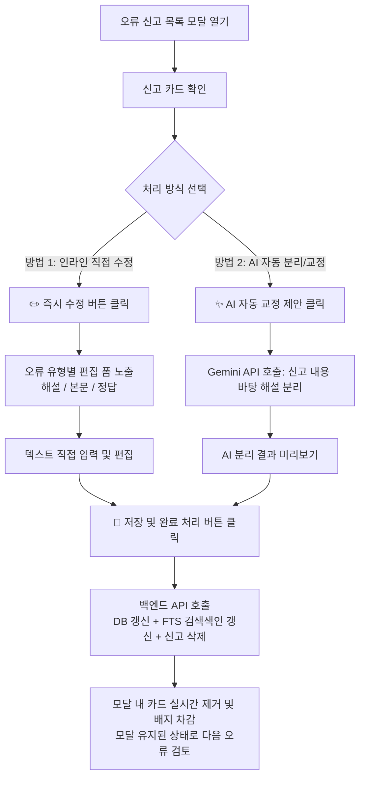
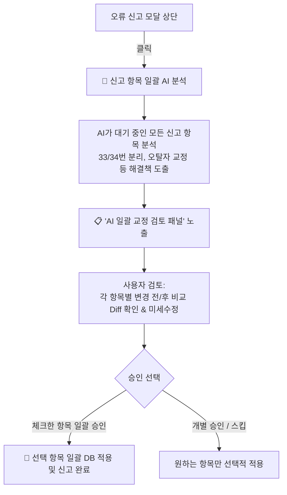

# 구현 계획서: 오류 신고 내역 확인 및 원스톱 인라인 수정·AI 자동 교정 시스템

**작성일시**: 2026-10-17  
**상태**: ✅ 완료  
**관련 요청**: 
- 오류 신고된 경우, 신고 내역을 확인하고 한 번에 직접 수정할 수 있는 버튼/기능 추가
- 오류 확인 후 직접 수정 또는 API 연결 가능 여부 질의 (수동 작업 탈피 및 원스톱 처리)
- 첨부 사례: 33번/34번 해설 누락·중복 문제 및 문항 텍스트 오류 신속 해결

---

## 1. 개요 및 배경

### 1.1. 현재 시스템의 한계
현재 '등록된 오류 신고 목록' 모달(`modalReportsList`)에서는 신고된 문항/문장 카드가 표시되지만, 액션 버튼이 **`[바로가기 ↗]`**와 **`[✅ 수정 완료 (삭제)]`** 2가지만 제공됩니다.
- `[바로가기 ↗]`를 누르면 모달이 닫히고 해당 문항의 2x2 결과 뷰어로 화면이 강제 전환됩니다.
- 그러나 결과 뷰어에서도 정답/메모/문제유형/수동 이미지 업로드는 지원되지만, **해설지 텍스트(`explanation_text`)나 지문 본문(`passage_text`)을 직접 수정할 수 있는 에디터가 없어** 관리자가 DB를 직접 열거나 다시 파싱해야 하는 불편함이 있습니다.
- 또한, 여러 건의 신고를 검토할 때 화면 전환을 반복해야 하므로 작업 동선이 매우 비효율적입니다.

### 1.2. 사용자 질문에 대한 명확한 해답
1. **"무조건 수동으로만 수정해야 하는 걸까?"**
   - 👉 **전혀 아닙니다.** 웹 애플리케이션 내에서 바로 DB를 업데이트하는 전용 API와 인라인 편집기를 연결하면 모달을 벗어나지 않고 그 자리에서 즉시 수정할 수 있습니다.
2. **"신고 내역을 확인하고 한번에 수정할 수 있도록 하는 버튼을 추가할 수 있을까?"**
   - 👉 **완전히 가능합니다.** 신고 카드마다 **`[✏️ 즉시 수정]`** 버튼을 추가하여, 모달 내부에서 해당 문항의 현재 해설/본문/정답을 펼쳐보고 바로 수정한 뒤 **`[💾 저장 및 수정 완료]`**를 누르면 한 번에 해결되도록 설계합니다.
3. **"필요하면 API 연결해서?"**
   - 👉 특히 첨부 이미지의 사례(`"33번 문항인데 33번과 34번 해설이 둘 다 들어 있음"`, `"34번에 해설이 없고 33번에 추가되어 있음"`)처럼 파싱 시 인접 문항의 해설이 합쳐진 경우, **Google Gemini AI API**를 호출하여 *"신고 내용에 따라 33번 해설과 34번 해설을 분리해줘"*라고 요청하면 **원클릭 AI 자동 분리/교정**이 가능합니다.

### 1.3. 현재 '오류 신고 내역 창' 시스템의 유지 원칙 (100% 보존 및 하위 호환)
사용자께서 만족해하시는 **현재의 오류 신고 내역 창 및 수동 검토 시스템은 단 하나도 삭제되거나 변경되지 않고 온전히 유지**됩니다:
- ✅ **헤더 우측 상단 배지 및 카운트 표시**: 현재와 완벽히 동일 유지
- ✅ **모달 디자인 및 탭 필터링 (`전체` / `문항 오류` / `문장 오류`)**: 현재와 완벽히 동일 유지
- ✅ **`[바로가기 ↗]` 버튼**: 클릭 시 해당 문항/문장 뷰어로 이동하여 전체 화면으로 꼼꼼히 확인하는 수동 워크플로우 100% 유지
- ✅ **`[✅ 수정 완료 (삭제)]` 버튼**: 수동으로 처리한 뒤 완료 처리하는 독립적인 삭제 버튼 100% 유지
- 💡 **이번 개선의 본질**: 기존 시스템을 대체(Replace)하는 것이 아니라, 기존 카드에 **추가 옵션(Add-on)**으로 `[✏️ 빠른 수정]` 선택지를 하나 더 얹어주는 비파괴적 확장입니다. 더불어 `[바로가기 ↗]`로 이동했을 때도 화면에서 해설 텍스트를 바로 고칠 수 있게 되어 기존 수동 시스템의 완성도가 한층 높아집니다.

---

## 2. 해결 전략 및 상세 설계

### 2.1. 방안 A: 오류 신고 모달 내 '원스톱 인라인 퀵 에디터(Quick Editor)'
- **위치**: 신고 카드 내 우측 액션 그룹 (`[바로가기 ↗]` 옆에 **`[✏️ 즉시 수정]`** 버튼 추가)
- **동작**:
  1. `[✏️ 즉시 수정]` 클릭 시 해당 카드 하단에 아코디언 형태로 **인라인 수정 패널**이 부드럽게 펼쳐집니다.
  2. 신고된 오류 유형(`error_types`)에 맞춰 필요한 편집 폼을 우선 노출합니다:
     - **해설지 오류**: 해설 텍스트(`explanation_text`) `textarea` 에디터 제공
     - **정답 오류**: ①~⑤ 정답 라디오 버튼 선택기 제공
     - **문항/문장 텍스트 오류**: 지문 본문(`passage_text`) 또는 문장(`sentence_text`) `textarea` 에디터 제공
     - **PDF 캡처 오류**: 이미지 드래그 앤 드롭 업로더 바로 노출
  3. 수정 후 **`[💾 수정 내용 저장 및 해결 완료]`** 클릭:
     - 문항 데이터(해설/본문/정답) DB 즉시 갱신 (`passages_fts` 검색 색인 자동 트리거 반영)
     - 해당 신고 항목 즉시 해결 처리 (`DELETE /api/reports/{id}`)
     - 모달을 닫지 않고 해당 카드만 페이드아웃 제거되며, 다음 신고 건을 바로 이어서 처리 가능

### 2.2. 방안 B: 인접 문항 연계 분할 및 AI API 자동 교정 (33번 ↔ 34번 해설 분리 특화)
- **사례**: 33번 문항에 33번+34번 해설이 모두 들어가 있고, 34번은 해설이 비어 있는 전형적인 파싱 뭉침 현상
- **지원 기능**:
  1. **[✂️ 34번으로 해설 잘라보내기] 버튼 (수동 분할 도구)**:
     - 현재 33번 해설 텍스트에서 34번에 해당하는 부분을 드래그하거나 커서를 두고 클릭하면, 뒷부분이 34번 문항의 해설로 자동 이관되고 33번에서는 삭제되어 양쪽 문항이 동시에 업데이트됨.
  2. **[✨ AI 자동 분리 제안] 버튼 (개별 연동)**:
     - 백엔드에 Gemini API 라우터(`POST /api/reports/{id}/ai-autofix`) 연결
     - 사용자의 신고 메시지와 현재 33번의 해설 텍스트를 AI에 전달해 33번/34번 분리 텍스트를 제안받음.

### 2.3. 방안 C: [🤖 신고 항목 일괄 AI 분석 및 사용자 검토 후 적용 (Batch Review)]
선생님께서 요청하신 핵심 안전장치: **"일괄로 AI 분석을 돌리되, 절대 AI가 제멋대로 DB를 덮어쓰지 않고 사용자가 Before/After 결과를 직접 확인한 후 승인한 것만 적용"**하는 워크플로우입니다.

- **상단 일괄 버튼**: 모달 상단 헤더/탭 영역에 **`[🤖 일괄 AI 분석 및 해결 제안]`** 버튼 추가
- **안전한 사용자 검토 패널 (Diff Review Panel)**:
  - AI 분석이 완료되면 **`📋 AI 분석 결과 검토 (N건)`** 화면이 모달 내에 생성됨
  - 각 항목별 카드 구성:
    - **오류 대상 & 신고 내용**: 예: `33번 [빈칸] - 33번과 34번 해설이 둘 다 들어 있음`
    - **AI 제안 액션**: `[33번 해설 정돈 & 34번 해설 주입 분할 제안]`
    - **비교(Diff) 뷰어**:
      - 🔴 **변경 전 (Before)**: 현재 DB에 저장된 텍스트
      - 🟢 **변경 후 (After / AI 제안)**: AI가 교정/분리한 텍스트 (텍스트창 형태로 제공되어 **관리자가 직접 타이핑으로 미세 수정 가능**)
    - **선택 체크박스 `[v]`**: 마음에 드는 제안만 체크
- **일괄 적용 액션**:
  - 하단 **`[💾 선택한 N건 일괄 승인 및 DB 적용]`** 버튼 클릭
  - 승인된 항목들만 DB에 일괄 저장되고, 해당 신고 내역이 일괄 삭제됨

---

## 3. 진행 현황 (Progress Tracker)

`/apply` 명령어를 통해 단계별로 즉시 실행할 수 있도록 작업을 세분화합니다.

| 단계 | 작업 내용 | 담당 영역 | 상태 |
|:---:|---|---|:---:|
| **1단계** | 백엔드 해설지/본문 텍스트 수정 REST API 신설 및 신고 목록 조회 컬럼 보강 | Python (FastAPI, SQLite) | ✅ 완료 |
| **2단계** | 프론트엔드 오류 신고 카드 내 `[✏️ 즉시 수정]` 인라인 에디터 패널 UI 구현 | JS, HTML, CSS | ✅ 완료 |
| **3단계** | Gemini AI 자동 분리/교정 API 구축 (개별 문항 + 일괄 분석 엔드포인트) | Python, Gemini API | ✅ 완료 |
| **4단계** | **`[🤖 일괄 AI 분석]` 및 `📋 Before/After 사용자 검토 패널(Diff & 미세수정)` UI 구현** | JS, HTML, CSS | ✅ 완료 |
| **5단계** | '선택 항목 일괄 승인 및 DB 적용' 트랜잭션 연동 & 실시간 목록 갱신 | JS, Python | ✅ 완료 |
| **6단계** | 터미널 정적 검증 및 실제 신고 케이스(33번, 34번, 18번) 연동 테스트 | Terminal 검증 | ✅ 완료 |

---

## 4. 세부 구현 계획

### 4.1. [1단계] 백엔드 데이터베이스 및 REST API 확장
1. **신고 목록 조회 시 본문/해설 데이터 포함 (`gichul/database.py`)**:
   - `get_error_reports()`의 SELECT 쿼리에 `p.passage_text`, `p.explanation_text`, `p.script_text` 추가
   - 프론트엔드가 모달을 열었을 때 추가 요청 없이도 즉시 해당 문항의 현재 텍스트를 표시할 수 있도록 최적화
2. **지문 해설 및 본문 텍스트 단독 수정 API 신설 (`gichul/routers/passages.py`)**:
   - `PATCH /api/passages/{passage_id}/explanation`: 해설 텍스트 업데이트 (`update_passage_explanation`)
   - `PATCH /api/passages/{passage_id}/text`: 지문 본문 텍스트 업데이트 (`update_passage_text`)
   - 두 API 모두 실행 시 기존 SQLite 트리거에 의해 `passages_fts` 전문 검색 인덱스가 자동으로 즉시 동기화됨

### 4.2. [2단계] 프론트엔드 오류 신고 카드 내 `[✏️ 즉시 수정]` 인라인 에디터
1. **카드 액션 버튼 추가 (`static/js/reports.js`)**:
   - 각 신고 카드 헤더에 `[✏️ 즉시 수정]` 버튼 배치
2. **인라인 에디터 폼 템플릿**:
   - 카드 하단에 숨김 영역(`report-inline-editor`) 생성
   - **탭/필드 구성**:
     - `해설 수정` (높이 자동 조절 textarea)
     - `정답 수정` (①, ②, ③, ④, ⑤ 라디오 버튼)
     - `지문 본문 수정` (필요 시 펼침)
   - **하단 액션**:
     - `[취소]`
     - `[💾 저장만 하기]`
     - `[💾 저장 및 신고 완료(삭제)]` (가장 자주 쓸 메인 액션)

### 4.3. [3단계] AI 자동 분리/교정 API 연동 (Gemini 활용)
1. **AI 자동 분리 엔드포인트 (`POST /api/reports/{id}/ai-split`)**:
   - 대상: 인접 문항 해설 분리 또는 오탈자 교정
   - 프롬프트: 사용자의 신고 코멘트 + 현재 문항 텍스트 + (인접 문항 정보)
   - 결과 포맷: `{ "success": true, "current_q_text": "...", "next_q_num": 34, "next_q_text": "..." }`
2. **프론트 UI**:
   - `해설지 오류` 태그가 있거나 코멘트에 "해설"이 포함된 경우 `[✨ AI 해설 자동 분리 제안]` 버튼 노출
   - 클릭 시 로딩 스피너 후 분리된 텍스트를 에디터에 자동 채워주어 관리자가 눈으로 확인 후 승인할 수 있도록 지원

### 4.4. [4단계] 통합 트랜잭션 및 UX 최적화
1. 저장 및 완료 버튼 클릭 시:
   - 본문/해설/정답 API 호출
   - 성공 시 `DELETE /api/reports/{id}` 자동 호출
   - 카드가 슬라이드업(slide-up)되며 목록에서 사라짐
   - 우측 상단 헤더의 배지 숫자 실시간 차감
   - 성공 토스트 알림: `"33번 해설이 수정되고 신고 처리가 완료되었습니다."`

---

## 5. 변경 대상 파일 목록

| 파일 경로 | 작업 내용 |
|---|---|
| `gichul/database.py` | `get_error_reports()`에 passage_text, explanation_text 필드 추가 |
| `gichul/routers/passages.py` | `PATCH /api/passages/{id}/explanation`, `PATCH /api/passages/{id}/text` 엔드포인트 추가 |
| `gichul/routers/reports.py` | (선택 사항) AI 자동 분리 라우터 `POST /api/reports/{id}/ai-split` 연동 |
| `static/js/reports.js` | 인라인 에디터 렌더링, 텍스트 편집, 원클릭 저장 및 삭제 이벤트 바인딩 |
| `static/css/modal.css` | 인라인 에디터 접기/펼치기 아코디언 스타일, textarea 및 버튼 스타일링 |

---

## 6. 사용자 확인 및 적용 안내

본 계획서는 `/ask` 원칙에 따라 소스 코드를 변경하지 않고 작성되었습니다.  
위 설계가 마음에 드시면 **`/apply`** 명령어를 입력해 주세요. 즉시 1단계부터 단계별 구현을 진행하겠습니다.
