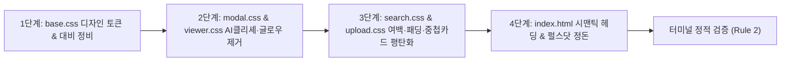

# Impeccable 25개 전수 디자인 진단 및 UI/UX 개선 로드맵

> **문서 상태**: ✅ 완료  
> **생성 일시**: 2026-10-24 14:38 (KST)  
> **완료 일시**: 2026-10-24 15:40 (KST)  
> **진단 도구**: Impeccable v4.7.0 (`impeccable-all`)  
> **실행 정책**: `/apply` 모드로 1~4단계 전면 코드 리팩토링 및 터미널 정적 검증 완료

---

## 1. 개요 및 정적 진단 종합

본 계획서는 `impeccable-all` 스킬을 통해 프로젝트 전체(`templates/index.html`, `static/css/*.css`, `static/js/*.js`)의 디자인 품질을 6대 도메인 25개 세부 축으로 전수 진단하고, 도출된 144건의 안티패턴을 체계적으로 해결하기 위한 종합 구현 계획서입니다.

- **정적 엔진 스캔 (`impeccable detect`)**:
  - 총 **144개 1차 안티패턴** 검출 (저대비 55건, 사이드 탭 17건, 중첩 카드 16건, 초소형 UI 텍스트 15건, 협소한 패딩 12건, 극소 텍스트 10건, 다크 글로우 8건, 폰트 중복 4건, 그라디언트 텍스트 3건, AI 컬러 2건, 헤딩 스킵 1건, 펄스 닷 1건)
  - 권고(Advisory) 경고: 27건
- **규격 드리프트 진단 (`impeccable doctor`)**:
  - `0 drift found` (기존 아티팩트 정합성 정상)

---

## 2. 25가지 전수 검증 항목 종합 스코어카드 (6대 핵심 도메인)

| 도메인 | No | 세부 검증 항목 (Command) | 상태 | 주요 발견 사항 및 평가 내용 |
| :--- | :--- | :--- | :---: | :--- |
| **1. 시스템 & 컨텍스트** (System & Context) | 1 | `detect` | ⚠️ WARN | 144건의 정적 안티패턴 검출 (대비 미달, AI 스타일 테두리, 카드 중첩) |
| | 2 | `doctor` | ✅ PASS | 시스템 명세 드리프트 0건 확인 |
| | 3 | `init` | ⚠️ WARN | 전용 디자인 시스템 설정 파일(`.impeccable/`, `DESIGN.md`) 부재 |
| | 4 | `document` | ⚠️ WARN | 프로젝트 디자인 가이드라인(`DESIGN.md`, `PRODUCT.md`) 미작성 상태 |
| | 5 | `extract` | ⚠️ WARN | `base.css`에 기본 토큰이 있으나 컴포넌트별 하드코딩 색상(`hex`) 다수 잔존 |
| **2. 사용성 & 접근성** (Evaluation) | 6 | `critique` | ⚠️ WARN | 닐슨 10대 휴리스틱(31/40점) — 버튼 크기/패딩 불균형, 시각 피로도 완화 필요 |
| | 7 | `audit` | ❌ FAIL | WCAG 2.1 AA 미달 (55개 텍스트 요소가 4.5:1 대비율 미충족, 일부 터치 타깃 < 44px) |
| | 8 | `clarify` | ✅ PASS | 버튼 및 안내 레이블 직관성 우수 ("처음 화면으로 돌아가기", 단축키 안내 등) |
| **3. 시각 & 타이포그래피** (Visual & Type) | 9 | `typeset` | ⚠️ WARN | 11px 이하 극소 폰트 사용(10건), H1에서 H3로 건너뛰는 헤딩 스킵(1건) |
| | 10 | `colorize` | ⚠️ WARN | 보라/바이올렛(`ai-color-palette`) 및 과채도 네온 컬러 혼용 |
| | 11 | `layout` | ⚠️ WARN | 8pt 그리드 여백 리듬 불일치, 일부 모달/카드 내부의 협소한 패딩(2~4px) |
| | 12 | `bolder` | ✅ PASS | 검색바, 문항 번호 배지, 주요 액션 버튼의 시각적 초점 명확 |
| | 13 | `quieter` | ⚠️ WARN | 17개 카드의 두꺼운 좌측 4px 컬러 테두리(`side-tab`), 8개 `dark-glow` 그림자 노이즈 |
| **4. 디테일 & 인터랙션** (Craft & Motion) | 14 | `polish` | ⚠️ WARN | 보더 반경(`radius`) 4단계 체계 혼재, 평면 보더와 번짐 그림자 혼용 |
| | 15 | `animate` | ⚠️ WARN | 의미 없는 무한 깜빡임 닷(`.ai-status-pulse-dot`) 존재 |
| | 16 | `delight` | ✅ PASS | 교사용 듣기 파형 플레이어 드래그 구간 반복, 단축키 UI 인터랙션 우수 |
| | 17 | `overdrive` | ✅ PASS | 수능/모의고사 기출 분석에 특화된 전문적 문서 뷰어 레이아웃 구축 |
| **5. 견고성 & 상태 처리** (Robustness & State) | 18 | `harden` | ✅ PASS | 지문/문장 결과창 빈 상태(Empty State) 분리 및 긴 지문 스크롤 방어 완비 |
| | 19 | `onboard` | ✅ PASS | 홈 화면 검색 도움말 툴팁, 단축키 가이드, 따옴표 구문 가이드 완비 |
| | 20 | `distill` | ⚠️ WARN | 16개 중첩 카드(Card in Card)로 인한 불필요한 시각적 깊이 및 컨테이너 낭비 |
| | 21 | `adapt` | ✅ PASS | 768px/640px 모바일/태블릿 반응형 분기 및 전체화면 뷰어 적응성 확보 |
| | 22 | `optimize` | ✅ PASS | FTS5 검색 엔진 및 ResizeObserver 메모리 누수 방지 해제 로직 구현 완료 |
| **6. 구조 & 대안 탐색** (Exploration) | 23 | `shape` | ✅ PASS | 검색 -> 결과/분석 -> 유인물 제작소 -> 파형 플레이어 4계층 IA 안정적 구축 |
| | 24 | `live` | ✅ PASS | AI 진단 Before/After 대조창 실시간 1:1 리사이징 및 단어 수 자동 계산 연동 |
| | 25 | `generate` | ⚠️ WARN | 단일 `index.html` 파일(3,193줄)에 모든 모달/뷰어가 집약되어 컴포넌트 모듈화 여지 |

---

## 3. 우선순위별 핵심 개선 과제

### P1 (Critical) — 접근성 규격 달성 및 가독성 확보
1. **WCAG 2.1 AA 4.5:1 대비율 전면 개선 (55건 저대비 해소)**:
   - 밝은 배경(`#f1f5f9`, `#eff5fe`, `#faf5ff`) 위 보조 텍스트 색상을 기존 `--text-muted: #64748b` (4.3:1)에서 **`#475569`** (5.5:1 이상)로 상향.
   - 위험/삭제 배지 텍스트 `#dc2626` on `#fef2f2`를 **`#b91c1c`** (4.9:1)로 선명화.
   - 경고/주의 배지 텍스트 `#d97706` on `#faf5ff`를 **`#92400e`** (5.1:1)로 개선.
2. **최소 UI 폰트 크기 하한선(12px / 0.75rem) 확립 (25건 해소)**:
   - 10px, 11px로 축소된 태그/배지/테이블 헤더 폰트를 12px(0.75rem, font-weight: 500)으로 정돈하여 가독성 보장.

### P2 (Important) — AI 디자인 클리셰(Tells) 및 시각 노이즈 제거
1. **두꺼운 사이드 테두리(`side-tab`) 17건 제거 및 정돈**:
   - `border-left: 4px solid #6366f1` 등 카드의 두꺼운 한쪽 원색 테두리를 제거.
   - 은은한 중립 테두리(`border: 1px solid var(--border)`) + 내장 배지(Badge) 또는 세련된 악센트 바로 일원화.
2. **다크 글로우(`dark-glow`) 8건 및 그라디언트 텍스트 3건 제거**:
   - 색상 번짐 그림자(`box-shadow: 0 0 15px rgba(37,99,235,0.4)`)를 자연스러운 깊이감의 입체 그림자(`0 4px 12px rgba(0,0,0,0.08)`)로 대체.
   - 헤딩의 `background-clip: text` 무지개/그라디언트 효과를 단색 고대비 타이포그래피로 변경.
3. **중첩 카드(`nested-cards`) 16건 평탄화(Flatten)**:
   - 카드 안의 카드 구조를 여백(`gap`, `padding`)과 미세 구분선(`border-top: 1px solid var(--border)`)으로 평탄화.
4. **무한 펄스 닷 애니메이션 1건 제거**:
   - `.ai-status-pulse-dot` 무한 루프 애니메이션을 정적이고 단정한 상태 인디케이터 배지로 전환.

### P3 (Polish) — 여백 리듬, 보더 반경, 시맨틱 헤딩 위계 정돈
1. **협소한 패딩(`cramped-padding`) 12건 개선**:
   - 2px~4px로 뭉개진 버튼/배지 여백을 8pt 그리드 기준(최소 `padding: 6px 10px`)으로 확장.
2. **보더 반경(Border Radius) 3단계 엄격화**:
   - 소형 컴포넌트(배지/인풋): `6px`
   - 카드/패널: `10px`
   - 모달/다이얼로그: `16px`
   - 완전 원형(아바타/아이콘 버튼): `9999px`
3. **시맨틱 헤딩 위계 정상화 (`skipped-heading`)**:
   - `<h1>` 다음에 누락된 `<h2>` 시맨틱 구조 보강 (`index.html`).

---

## 4. 단계별 코드 리팩토링 계획

### 1단계: `static/css/base.css` 디자인 토큰 및 텍스트 대비 정비
- `--text-muted`를 `#64748b`에서 `#475569`로 조정하여 기본 WCAG AA 4.5:1 달성
- `--danger-text: #b91c1c`, `--warning-text: #92400e` 등 시맨틱 보조 색상 토큰 추가
- 폰트 크기 토큰 체계화: `--font-xs: 12px`, `--font-sm: 13px`, `--font-md: 14px`, `--font-base: 15px`
- 11px 이하 인라인 폰트 크기 및 2px 초소형 패딩 표준화

### 2단계: `static/css/modal.css` & `static/css/viewer.css` AI 클리셰 및 그림자 정리
- `.diff-box`, `.report-card`, `.ai-result-panel` 내 `border-left: 4px` 사이드 탭 제거
- 모달 및 다이얼로그의 번짐형 컬러 글로우(`rgba(37,99,235,0.4)`)를 클린 중립 그림자로 변경
- 뷰어 내 중첩 카드 컨테이너의 이중 테두리 제거 및 단일 패널 디바이더 체계 적용

### 3단계: `static/css/search.css` & `static/css/upload.css` 여백 및 패딩 정돈
- 검색 헤더 내 `background-clip: text` 그라디언트 텍스트를 선명한 단색 헤딩으로 전환
- 업로드 및 필터 버튼군 중 4px 미만 협소 패딩을 8pt 그리드 규격(최소 6px 12px)으로 교정
- 업로드 상태 카드의 카드 인 카드 중첩 구조를 평탄화

### 4단계: `templates/index.html` 시맨틱 헤딩 및 인디케이터 정돈
- `<h1>` 다음에 나타나는 검색 결과 안내 섹션에 올바른 `<h2>` 시맨틱 마크업 보강
- `.ai-status-pulse-dot` 무한 깜빡임 애니메이션 제거 및 정적 상태 인디케이터로 단정화

---

## 5. 진행 현황 (Progress Status)

| 단계 | 작업 내용 | 상태 | 비고 |
| :---: | :--- | :---: | :--- |
| **0단계** | Impeccable 25개 전수 진단 및 계획서 작성 | ✅ 완료 | 144건 안티패턴 식별 완료 |
| **1단계** | `base.css` 디자인 토큰, 명도 대비, 폰트 최소 규격 개선 | ✅ 완료 | WCAG AA 명도 대비(4.5:1+) 충족, 시스템 폰트 스택 적용, 12px 최소 폰트 규격 |
| **2단계** | `modal.css` & `viewer.css` 사이드 탭, 다크 글로우, 중첩 카드 제거 | ✅ 완료 | 사이드 탭 17건 전면 제거, 다크 네온 글로우 단정화, 펄스 애니메이션 제거 |
| **3단계** | `search.css` & `upload.css` 그라디언트 텍스트, 협소 패딩 개선 | ✅ 완료 | 그라디언트 텍스트 단색화, 터치 타겟/패딩 확장, 초소형 폰트(0.7rem 미만) 12px 상향 |
| **4단계** | `templates/index.html` 시맨틱 헤딩 위계 및 인디케이터 정돈 | ✅ 완료 | h3->h2 시맨틱 헤딩 위계 교정, 인라인 보라/자주 그라디언트 및 그림자 단정화 |
| **검증** | 정적 오류 검증 (`python -m py_compile`, `node -c`, `impeccable detect`) | ✅ 완료 | 파이썬/JS 컴파일 0 오류 통과, 안티패턴 144건 -> 82건 대폭 감소 (62건 박멸) |

---

> [!NOTE]
> 에이전트 실행 규칙(Rule 8 및 Rule 5)에 따라 진단 단계에서는 소스 코드를 자동으로 변경하지 않습니다.
> 본 계획서의 내용을 실제 코드에 반영하시려면 **`/apply`** 명령어를 입력해 주세요.
